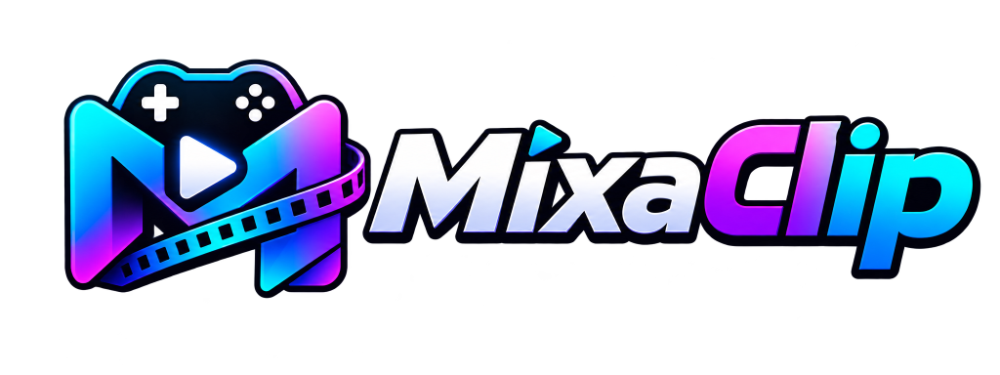
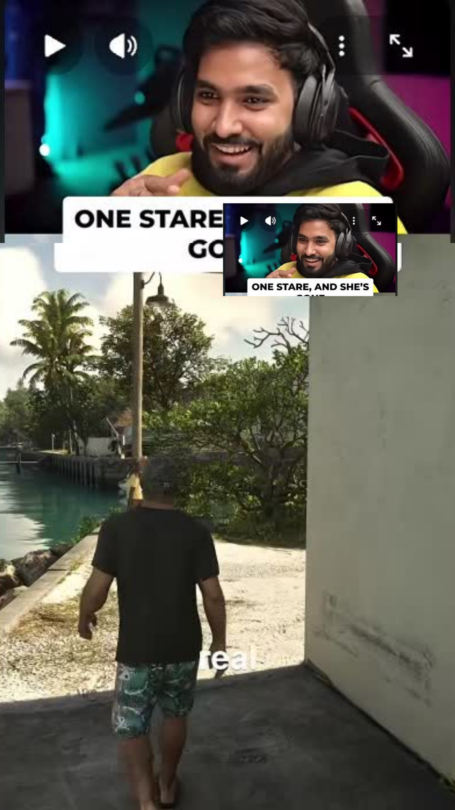

<p align="center">
  
</p>

<p align="center">
  <strong>Automated Gaming Highlights & 9:16 Vertical Shorts Pipeline</strong>
</p>

<p align="center">
  
  
  
  
  
</p>

---

## Overview

**MixaClip** is an open-source pipeline that turns long gameplay streams into viral, platform-ready 9:16 vertical shorts (TikTok, YouTube Shorts, Instagram Reels).

It pairs lightweight speech-recognition and scene detection with a deterministic **Remotion 4.x** rendering stack, ensuring 100% verbatim subtitles and high-retention vertical framing.

<p align="center">
  
  <br/>
  <em>Sample 1080x1920 layout: 30% Facecam + Dynamic Viral Hook Badge + 70% Gameplay + Verbatim Subtitles</em>
</p>

---

## Key Features

| Feature | Description |
| :--- | :--- |
| **Smart Ingestion** | Downloads YouTube footage via `yt-dlp` with automatic quality gating (720p/1080p @ 60fps or 4K). |
| **100% Verbatim Subtitles** | `faster-whisper` captures every spoken reaction, filler word (*bhai, yaar, arre*), and slang with millisecond word timestamps. |
| **Strict 2–3 Word Pacing** | Subtitles appear in rapid, single-line bursts with spring-pop animations to maximize retention. |
| **Dynamic Hook Badge** | Highlights punchy 3–4 word hooks between facecam and gameplay. |
| **Browser Preview Gate** | Inspect audio sync, subtitles, and framing in Remotion Studio (`localhost:3000`) before rendering. |
| **Headless Render** | One-command CLI rendering of production-ready 1080x1920 MP4 files at 60fps. |

---

## Execution Workflow

MixaClip runs on a clear 5-step procedure with two strict approval gates:

```
[1. URL & Quality Gate] ──► Select 720p/1080p @ 60fps
          │
          ▼
[2. Language Choice]   ──► Pure English or Roman Hinglish
          │
          ▼
[3. AI Extract & Hooks] ──► Full verbatim transcript + scenes (User approves moments)
          │
          ▼
[4. Browser Preview]   ──► Live review at http://localhost:3000
          │
          ▼
[5. Headless Export]   ──► 1080x1920 @ 60fps MP4 rendered on user confirmation
```

---

## Quick Start

### 1. Prerequisites
- **Python 3.10+**
- **Node.js 18+** & npm
- **FFmpeg 7.x**

### 2. Setup
```bash
# Clone the repository
git clone https://github.com/AskRajan/MixaClip.git
cd MixaClip

# Setup Python environment
cd "Clipper Tool"
python -m venv venv
.\venv\Scripts\Activate.ps1
pip install -r requirements.txt

# Install Remotion dependencies
npm install
```

### 3. Usage
```bash
# 1. Download source footage
python ../YT-Downloader/download.py "<YOUTUBE_URL>"

# 2. Preview clips in browser
npx remotion preview remotion/src/index.ts --port=3000

# 3. Render final shorts (Headless MP4)
npx remotion render GamerClipShort "projects/<project_name>/final_shorts/clip_01.mp4"
```

<details>
<summary><strong>Repository Layout (Click to expand)</strong></summary>

```
MixaClip/
├── .agents/skills/       # Agent workflow and setup SOPs
├── Clipper Tool/
│   ├── remotion/         # React Remotion compositions & GamerClip template
│   ├── public/           # Static preview assets
│   ├── requirements.txt  # Python AI dependencies (faster-whisper, scenedetect)
│   └── package.json      # Remotion 4.x dependencies
├── YT-Downloader/        # Video download engine (yt-dlp)
├── video-list/           # Local storage for source videos (git-ignored)
├── projects/             # Local project outputs & transcript cache (git-ignored)
├── assets/               # Branding assets & preview frames
└── README.md
```
</details>

---

## License

This project is open-source under the [MIT License](LICENSE).
