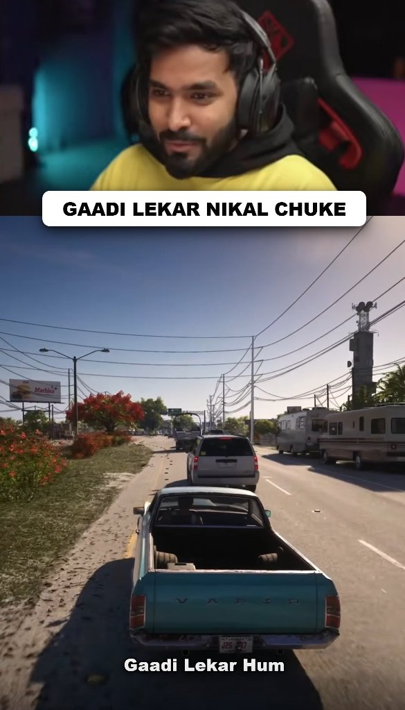
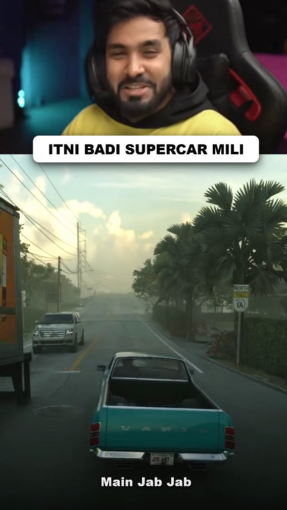
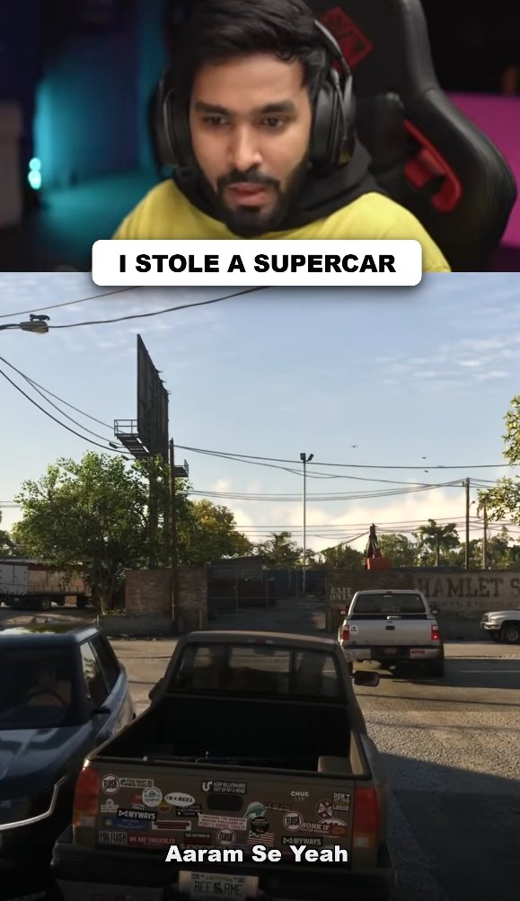

<p align="center">
  
</p>

<p align="center">
  <strong>Automated Gaming Highlights & 9:16 Vertical Shorts Pipeline</strong>
</p>

<p align="center">
  
  
  
  
  
</p>

---

## Overview

**MixaClip** is an ultra-fast, open-source pipeline that turns long gameplay streams into viral, platform-ready 9:16 vertical shorts (TikTok, YouTube Shorts, Instagram Reels).

Powered by lightweight speech-recognition (`faster-whisper`), visual scene detection (`PySceneDetect`), and a high-performance **direct FFmpeg compositing engine**, MixaClip delivers 100% verbatim subtitles and punchy viral hook badges in **under 10 seconds per clip** without heavy browser overhead.

<p align="center">
  
  &nbsp;
  
  &nbsp;
  
</p>
<p align="center">
  <em>Sample 9:16 Vertical Shorts: Top 30% Facecam + Dynamic Viral Hook Badge + Bottom 70% Gameplay + Verbatim Subtitles</em>
</p>

---

## Key Features

| Feature | Description |
| :--- | :--- |
| **Smart Ingestion** | Downloads YouTube footage via `yt-dlp` with automatic quality gating (720p/1080p @ 60fps or 4K). |
| **100% Verbatim Subtitles** | `faster-whisper` captures every spoken reaction, filler word (*bhai, yaar, arre*), and slang with millisecond word timestamps. |
| **Strict 2–3 Word Pacing** | Subtitles appear in rapid, single-line bursts with high-contrast outlines and drop shadows to maximize retention. |
| **Dynamic Hook Badge** | Highlights punchy 3–4 word hooks between facecam and gameplay. |
| **Ultra-Fast FFmpeg Engine** | 100% native C++ rendering: exports an entire 28s short in **5 to 10 seconds** on standard laptops (Ryzen / Intel). Zero browser overhead. |
| **Organized Output Structure** | All generated shorts are cleanly saved inside `Output/Project_1/`, `Output/Project_2/`, etc. |

---

## Execution Workflow

MixaClip runs on a streamlined 4-step procedure with a strict approval gate:

```
[1. URL & Quality Gate]  ──► Select 720p / 1080p @ 30/60fps
          │
          ▼
[2. Language & Template] ──► Pure English or Roman Hinglish | Split-Screen or PIP
          │
          ▼
[3. AI Extract & Hooks]  ──► Full verbatim transcript + viral moments with catchy hooks
          │
          ▼
[4. User Approval Gate]  ──► User approves proposed moments & hook titles
          │
          ▼
[5. Ultra-Fast Export]   ──► All clips rendered directly into MixaClip/Output/Project_X/ in seconds!
```

---

## Quick Start

### 1. Prerequisites
- **Python 3.10+**
- **FFmpeg 7.x+** (via system PATH or placed in `bin/ffmpeg/bin/ffmpeg.exe`)

### 2. Setup
```bash
# Clone the repository
git clone https://github.com/AskRajan/MixaClip.git
cd MixaClip

# Setup Python virtual environment
python -m venv venv
.\venv\Scripts\Activate.ps1
pip install -r requirements.txt
pip install -e .
```

### 3. Usage

#### System Health Check
```bash
python -m mixaclip check
```

#### Step 1: Download Source Video
```bash
python -m mixaclip run "<YOUTUBE_URL>" --quality 720p30
```

#### Step 2: Export All Approved Clips (Ultra-Fast)
```bash
python -m mixaclip export --moments "storage/cache/<Project_Name>/moments.json"
```
*All clips are instantly exported to `storage/output/Project_1/` (or next project index).*

---

## Repository Layout

```
MixaClip/
├── .agents/skills/         # Agent workflows and setup SOPs
├── assets/                 # Branding assets & sample frames
├── bin/                    # Local portable binaries (FFmpeg, yt-dlp) [git-ignored]
├── docs/                   # Architecture & documentation guides
├── src/                    # Modular Python package
│   └── mixaclip/
│       ├── cli.py          # Unified CLI entrypoint
│       ├── core/           # Downloader, transcriber, moments & FFmpeg exporter
│       ├── templates/      # Split-screen & PIP templates
│       └── utils/          # Aspect ratio preservation & formatting
├── storage/                # Media storage [git-ignored]
│   ├── downloads/          # Raw downloaded source videos
│   ├── cache/              # Whisper transcripts & scene cache
│   └── output/             # Final exported vertical shorts (Project_1, Project_2, etc.)
├── tests/                  # Automated unit & integration tests
├── pyproject.toml          # PEP 518/621 packaging configuration
├── requirements.txt        # Unified dependency specifications
└── README.md
```

---

## License

This project is open-source under the [MIT License](LICENSE).
